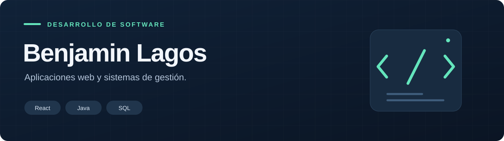
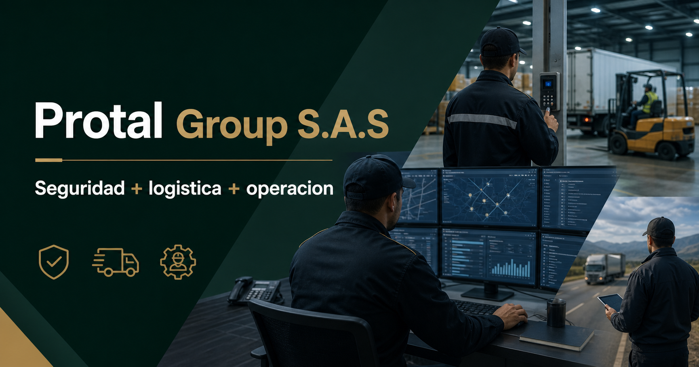

### Interfaces claras. Sistemas para el trabajo de todos los días.

Desarrollo aplicaciones web con **React, Java y SQL**.  
En mis proyectos combino interfaz, lógica de negocio y persistencia de datos.

[Proyecto destacado](https://github.com/benjapato/la-ferreteria) · [Sitio institucional](https://github.com/benjapato/protal-group-web) · [Más proyectos](https://github.com/benjapato?tab=repositories)

## Proyecto destacado

### La Ferretería — Sistema de gestión comercial

Una aplicación para reunir ventas, inventario, clientes, compras y caja en un mismo lugar.

**React · Java 21 · Spring Boot · PostgreSQL**

- Venta de productos, historial y comprobantes.
- Catálogo, control de stock y alertas de reposición.
- Clientes, cuentas corrientes, proveedores y compras.
- Caja, reportes y acceso según el rol del usuario.

[**Explorar el proyecto →**](https://github.com/benjapato/la-ferreteria)

## También construí

### Protal Group S.A.S — Sitio institucional

Una web para presentar servicios empresariales, con diseño adaptable, páginas de inicio y contacto y una identidad visual consistente.

**React · TypeScript · vinext · Vite · CSS**

[**Ver el código y el alcance →**](https://github.com/benjapato/protal-group-web)

## Tecnologías que uso en estos proyectos

| Interfaz | Backend y datos | Herramientas |
| :--- | :--- | :--- |
| React, JavaScript, TypeScript, HTML, CSS | Java, Spring Boot, Spring Security, JPA, PostgreSQL | Git, Vite, Gradle, npm, pnpm |

Las capturas de La Ferretería usan datos ficticios de demostración.
